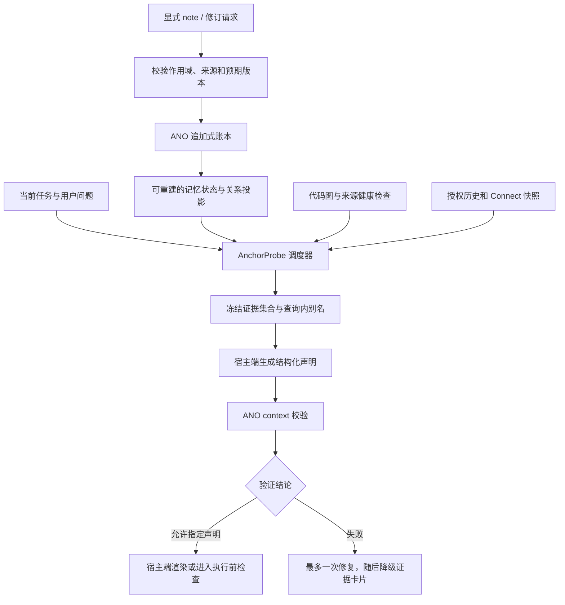

# AnchorProbe 与 ANO 集成方案

- 日期：2026-11-21；最终对账：2026-11-22
- 状态：**P0–P4 已实施；M8 24/24 任务完成并验收；五个阶段 gate 全部通过。**
- 范围：在 ANO 现有账本、结构图、Memory、MCP 和 Gate 之上增加版本化记忆与证据消费协议。
- 最终交付：集成实现、测试、质量报告与研究对账；未修改用户级 MCP 注册或自动 cutover。真实模型、宿主自动拦截、跨项目现场消费、掉电持久性与 BitChain 端到端收益仍为 §17.7 的未验证边界。

## 1. 目标与推荐路径

把 AnchorProbe 实现为 ANO 的记忆治理与证据检索组件：写入时维护事实版本和关系，读取时组装有来源、作用域、时间和缺口说明的上下文，消费后验证结构化回答。先使用现有 SQLite、FTS、SHA-256 和代码图建立正确性基线，再用相同语义接口评估 BitChain 加速后端。

第一阶段的成功标准是：相同输入与快照得到可复核结果；不把失效、冲突或无来源内容冒充当前事实；旧接口继续工作。十倍提速、开放式语义召回百分百和模型零幻觉均为未验证目标，不是接口保证。

落地顺序：锚点接线与只读探针 → 版本化写入 → 快照载荷与回答验证 → 宿主端消费闭环 → 分类器与 BitChain 对照实验。

## 2. 当前代码基础与接入点

以下位置依据本次代码定位和读取。行号用于定位当前版本；实施时按符号搜索，不将行号写入持久记忆身份。

| 现有位置 | 已有能力 | 集成动作 |
|---|---|---|
| `src/memory/anchor.ts`，`resolveAnchor` | 符号 ID、限定名称、内容片段/文件哈希重定位及 stale 原因 | 作为探针的来源健康检查，保留已有降级语义 |
| `src/surface/service.ts:70`，`brief` | 汇总任务、记忆、代码图新鲜度和 Connect 状态 | 修复符号表未传入 anchor source 的接线，增加可选上下文输出 |
| `src/surface/service.ts:92` | 当前调用 `anchorSourceFromFileSystem(projectRoot)` 未传 symbols | 组合 graph snapshot 的 symbols 与文件读取器；图陈旧时不能把符号命中报告为新鲜证据 |
| `src/memory/brief.ts`，`buildMemoryBrief` | 记忆聚合、相关性过滤、stale 分离 | 复用过滤与重定位结果，新增明确的版本/权限/预算过滤 |
| `src/memory/store.ts`，`HistoryStore.recall` | 合成历史、FTS/BM25、结构化条件、LIKE 回退 | 用作历史候选源；历史命中不得自动升级为已批准事实 |
| `src/ledger/event.ts:10`、`:54` | 追加式事件词汇表与 SHA-256 事件哈希 | 新增独立事件；保留所有已提交事件的原字节与哈希 |
| `src/ledger/ledger.ts:168`、`:193` | 幂等追加、共享视图锁、事件提交与重放 | 新的记忆变更必须在锁内检查前置版本，禁止先查后写的竞争窗口 |
| `src/ledger/views.ts:16`、`:77` | 版本化、可重建的 SQLite 视图与 notes 投影 | 追加新的状态/关系投影，视图版本升级后从账本重建 |
| `src/surface/memory.ts`，`noteSurface` | 校验、记账、回读 | 增加显式修订/关联路径，保留原 note 写入语义 |
| `src/surface/tool-catalog.ts:103`、`src/surface/mcp.ts:23` | 七个严格 Schema 的 MCP 工具及分发 | 在已有工具内增加可辨别模式；不新增第八个工具 |
| `src/gate/verify.ts`，`verifyTask` | 基于实际执行证据的任务验证 | 不接收语义回答校验结果作为任务完成证据 |
| `src/connect/active.ts`、`src/connect/canonical.ts` | Connect 快照/提交指针及内容哈希 | 在已授权根目录内作为独立来源适配器，保留未验证标记 |

现有 `src/memory/note.ts` 部分注释仍描述 note 事件尚未接线，但实际事件、Surface 和投影已经存在。实施时以运行代码和测试为准，并在相关改动中修正过期注释，不依据旧注释重做系统。

## 3. 架构与责任划分



责任边界：

- Ledger 保存可追溯记录；Memory 投影保存可重建的当前读模型。
- Probe 负责候选路由、来源检查、预算与载荷，不负责宣布模型回答正确。
- 回答校验检查结构、引用与已形式化规则；自由文本语义支持度独立评测。
- 宿主客户端负责调用时序、缓冲输出、重试及执行前拦截。MCP 服务独自不能截获客户端之后生成的文字。
- Gate 继续根据现有执行证据判断任务/发布条件。记忆声明不能改变任务完成、attestation、release approve 和 cutover 的权限。

## 4. 记忆数据模型

### 4.1 区分内容、事实、记录和来源健康

保留现有 `note_id` 的生成规则，不给历史 note 重新编号。新增模型采用以下身份：

| 字段 | 含义 |
|---|---|
| `project_scope` | 选定项目的本地命名空间；与调用的规范根目录绑定 |
| `fact_key` | 作用域内的事实槽位，例如 `local.storage.engine`；没有明确槽位的自由文本不能自动覆写其他记录 |
| `record_ref` | 账本事件 ID；同文不同时间/项目的记录保持不同身份 |
| `note_id` | 兼容现有 note 的内容身份 |
| `content_hash` | 现有 SHA-256 的规范内容摘要；哈希用于身份/完整性，不用于判断语义正确 |
| `effective_from/to` | 业务生效区间；未知时标记未知，不用记录时间伪装 |
| `recorded_at` | 记录进入账本的时间；保留现有 HLC 排序信息 |
| `status` | `active / superseded / conflicted / retracted` |
| `provenance` | 原生 note、代码读取、Connect 来源或历史；附来源摘要与新鲜度 |
| `authority` | 来源的声明/批准依据；模型置信度不能提升权限 |

锚点重定位失败的 `stale` 是来源健康，不等于业务状态 `superseded`。旧方案被明确替代与文件移动失联必须分开记录。

### 4.2 写入事件

事件词汇、payload 与前置条件已在 ADR-005（docs/adr/ADR-005-anchorprobe-memory-revision.md）中固定，实现按该 ADR 执行，不再另行决策。本节保留设计意图说明：

1. `memory.revised`：一次事件包含新记录内容、目标事实槽位、被替代的 `record_ref`、原因、生效区间和预期前置版本（即 `supersedes` 引用）。投影同时登记新版本与旧版本的替代关系，避免“先记新块、再废弃旧块”的两次提交窗口；撤回是同一事件的 `intent=retract` 分支。
2. `memory.related`：一次事件包含源/目标记录和有类型的边，词汇固定为 `depends_on / explains / related_to`。关系不改变事实生效状态，相关性高也不能自动废弃旧记录。
3. `memory.conflict.resolved`：显式冲突裁决事件，引用同一 `fact_key` 的全部分叉分支，outcome 固定为 `winner / record / retract_all` 三种（ADR-005 §4.3）。

无替代关系的新自由文本继续走现有 `note.recorded`。新版本事件内含完整的新记忆记录，不要求预先调用一次 note；同一业务修订只提交一次。

前置条件在 Ledger 的共享锁内验证：目标存在、同作用域、预期版本仍匹配、无自环/替代环、调用操作符合允许策略。重复幂等键同参返回原结果，不同参拒绝。记录时间晚不等于获得覆写授权。

并发的分叉版本不靠 HLC 的最后一条自动选真值：依赖相同旧版本的竞争修订必须被拒绝或在重放中投影为 `conflicted`。完整的冲突裁决再追加新事件，并引用所裁决的所有分支。

L1 不自动从历史中“提炼成真值”。第一版只纳入显式指定的项目约束与当前任务状态，记录来源。自然语言约束是提示材料；只有已形式化的规则才能获得确定性违规检查。

### 4.3 投影与索引

P1 新增逻辑表已在 ADR-005 §10 固定为：`memory_records`、`memory_heads`、`memory_edges`、`memory_conflicts`；实体/别名索引与 FTS 均为可重建缓存。设计阶段建议的 `memory_invariants` 名额保留给已形式化规则落地时（P2+），P1 不建。

对旧 note：保留原始记录；仅有代码锚点不意味着其业务内容仍有效。旧 note 在没有版本治理前标记为 `legacy_unreviewed` 来源资格，不自动成为硬约束或机器验证事实。

## 5. 读取流程

1. 绑定显式 root、项目作用域和请求 ID，读取账本提交点、图 revision/source fingerprint 与所用 Connect digest。
2. 根据事实槽位、任务 ID、文件/符号定位入口；允许调用方提供待回答属性，但标记问题解析结果的来源。
3. 对候选做版本、生效区间、来源资格和锚点健康过滤。
4. 沿有类型的边执行有界遍历。区分代码静态依赖与已确认的业务事实关系，保留 heuristic/unknown 标记。
5. 没有入口、入口有歧义或必要事实缺失时，在剩余预算内进入慢道。索引读取错误走错误恢复，不假装无命中。
6. 按预算冻结证据集合，生成 `I1/E1/H1` 等请求内唯一别名和后端映射。
7. 输出载荷、缺失事实、冲突和截断原因。

预算参数是可配置的实验起点：初始候选 16、最多访问 12 个节点、最大深度 3。不得把这些数值描述成已优化结果；硬约束闭包超预算时必须报告不足，不静默删减后声称完整。

`early_stopped` 单独使用不足以表达完成状态。应同时报告 `stop_reason` 和 `retrieval_completeness`。提前完成只有在声明范围内所需条件已经检查时，才能标记该范围完整；预算/超时截断必须为 `PARTIAL/UNKNOWN`。

## 6. 载荷、快照与回答契约

建议新增 `src/memory/probe-contract.ts`，用现有 Zod 定义严格输入/输出 Schema，并生成可分发的 JSON Schema。禁止把示例字面值当成唯一合法值。

```json
{
  "schema_version": "anchorprobe.context.v1",
  "request_id": "opaque-request-id",
  "context_id": "server-issued-context-id",
  "snapshot": {
    "project_scope": "opaque-project-scope",
    "ledger_digest": "full-digest",
    "graph_revision": "revision-or-null",
    "source_fingerprint": "full-digest-or-null",
    "connected_digest": null
  },
  "execution_status": "OK",
  "temporal_mode": "CURRENT",
  "budget_status": {
    "stop_reason": "FRONTIER_EXHAUSTED",
    "retrieval_completeness": "COMPLETE_WITHIN_DECLARED_SCOPE",
    "nodes_visited": 2,
    "frontier_remaining": 0
  },
  "coverage_gate": {
    "status": "INSUFFICIENT",
    "required_facts": ["local.storage.engine", "local.storage.retention"],
    "missing_facts": ["local.storage.retention"],
    "unresolved_conflicts": [],
    "requirements_origin": "caller_declared"
  },
  "l1_invariants": [],
  "active_evidence": [
    {
      "ref": "E1",
      "record_ref": "ledger-event-id",
      "content_hash": "full-sha256",
      "status": "active",
      "source_health": "verified_at_snapshot",
      "recorded_at": "2026-11-21T00:00:00.000Z",
      "effective_from": null,
      "source": { "kind": "native_note", "path": "docs/example.md" },
      "content": "此处仅为接口示例，不是项目实际事实。"
    }
  ],
  "deprecated_tombstones": [],
  "untrusted": true
}
```

这是接口示例，不能作为真实项目状态注入。未知值使用 Schema 允许的 null/unknown；不伪造纳秒精度。若提供 `timestamp_ns`，编码为十进制字符串。

完整性限定于快照和声明范围，`coverage_gate` 检查所需事实，二者不得互相替代。没有问题事实集合时不能用实体覆盖率 1.0 声称语义完整。

后端冻结的 manifest 记录完整引用映射、内容摘要、版本、作用域、来源新鲜度、规则和证据文本。建议置于 `.ano/memory/probes/<context_id>.json`，作为有 TTL/容量上限的派生资料，并明确隐私、清理和备份策略；需要长期研究复现时显式导出已授权实验制品。不能仅相信调用方在 verify 时重新提交的 payload。

跨 Ledger/Graph/Connect 没有现成分布式事务。实现时在采样前后校验组件摘要；任一发生变化就限次重采样，仍变化返回 `SNAPSHOT_UNSTABLE`。使用到的文件还须校验读取摘要。执行前重新检查源指纹，不把生成时快照当成执行时永远有效。

建议消费端输出：

```json
{
  "context_id": "server-issued-context-id",
  "claims": [
    {
      "id": "C1",
      "kind": "CURRENT_FACT",
      "text": "与证据一致的单条陈述",
      "evidence_refs": ["E1"]
    }
  ],
  "not_applicable": [],
  "unresolved": ["local.storage.retention"]
}
```

提案、推导、当前事实和历史解释分别标记。旧 PostgreSQL 连接池在已迁移 SQLite 的作用域内应标记“不适用”，不能编造数值，也不必强迫用户补旧参数。历史提问可回取旧原文并标记历史用途，禁止将历史证据升级为当前执行依据。

严格约束检查返回 `status=ALLOW/BLOCK/NEEDS_REVIEW`、各层校验结果和具体 violations。结构通过、引用有效、语义支持度未知时，应返回 `NEEDS_REVIEW`，不得合并为泛化的 `passed=true`。

## 7. 兼容现有七工具的接口增量

以下为待实现接口，不是当前可用命令。现有无新字段调用保持原行为及结果形状；新增字段使用互斥 Schema 分支并拒绝未知字段。

| 工具 | 建议增量 | 保持的边界 |
|---|---|---|
| `brief` | 可选 `include_memory_context=true` 与上下文预算 | 默认输出不变；不宣称服务端能让客户端每轮必调 |
| `recall` | 新增 `mode="probe"` 分支，要求 query，可选 requirements/temporal_mode/as_of/budget | 旧历史调用与 `source="connected"` 旧语义不变；probe 来源适配显式选择 |
| `note` | 保留旧记录分支；新增 `operation="revise"`、`operation="relate"` 严格分支 | 写入需 idem_key、目标记录和前置版本；模型分类不获得批准权限 |
| `verify` | 新增 `scope="context"`，输入 context_id 与结构化 draft | 从服务端 manifest 取证；不产出 task/release Gate evidence_id，不触发 done |
| `explore` | 复用代码图查询结果作为显式候选适配器 | 不把 heuristic 静态关系包装成运行时事实 |
| `track` | 无新完成通道 | `complete` 继续要求现有 Gate evidence_id |
| `audit` | 首期不扩展 | 后续需要记忆一致性审计时单独增加严格 scope |

`verify scope=context` 不启动 shell、不执行 draft 中的命令；context_id 未知、过期、跨作用域或摘要失配直接阻止。任务/发布分支继续使用现有参数与证据路径；上下文校验输出类型必须与 Gate 类型分离。

需联动修改 `src/surface/tool-catalog.ts`、`src/surface/mcp.ts`、`src/surface/service.ts`、`src/surface/cli.ts`、`src/index.ts`、文档生成说明及 Schema 测试。七工具数量不变不代表无需升级客户端工具 Schema。

CLI 建议增加 `ano recall --mode probe --query ...`、`ano verify context --context-id ... --draft <path>` 与显式 note 修订参数，路径输入只读解析 JSON，不执行文件内容。具体语法应与现有 CLI 解析约定统一。

## 8. 校验器与宿主集成

### 8.1 校验器

第一版确定性检查：Schema/枚举/大小限制；引用唯一且属于冻结集合；项目与版本匹配；当前执行不能引用失效证据；已形式化的参数值和约束一致；缺失事实没有被填造；不接受未定义 gate 状态。

“每条 claim 有引用”仍不证明引用支持 claim。自由文本语义验证采用可替换接口，第一版标记 unknown；以后引入 NLI/分类器时报告错误放行、错误拦截和校准结果。自然语言 L1 的遵循不能由正则保证。

### 8.2 宿主消费闭环

建议增加库级 `src/memory/consumer.ts`，通过注入模型适配器完成以下调用协议，核心不绑定某家模型 API：

1. 每次关键操作前取 brief/probe，上下文按作用域注入。
2. 接收结构化 draft，先缓冲，调用 context 校验。
3. 失败时基于固定快照最多修复一次；期间快照失效就重新探测，限制总预算。
4. 再次失败则返回后端渲染的证据卡片、缺口和冲突。
5. 只有验证允许的声明才展示或送入下一步执行前检查。

ZCode 若无相应输出拦截/适配接口，只能先实现可运行的本地消费 harness 和显式 verify 工具流。提示词要求 agent 自觉调用，不等于已验证的自动拦截。本方案不改用户级 MCP 注册，不将全局服务 root 固定为 ANO 源码目录。

验证证据分层记录：库测试、真实 stdio、当前会话工具可调用、Settings/UI 发现、第二个项目使用，分别验收；任何一层成功不能代替其他层。

## 9. 决策模型与 BitChain 的保留方式

### 9.1 决策模型

保留用户的“轻量决策模型”，将其定位为候选关系提议器：`unrelated / continuation / cross_link / supersede_candidate`。标签编码可以紧凑，但不把 2-bit 编码当作推理优化证据。

候选粗筛复用实体/词法索引，模型比较限量候选。相关性、矛盾、同作用域和替代权限分别判定；supersede_candidate 经过确定性前置检查才提交。无法确认则保持冲突或待审，不静默废弃。第一版使用规则和显式输入跑通，无需模型、GPU 或额外云端依赖。

### 9.2 BitChain

保留“定长块头＋有界段＋跨段关系＋按需载荷”的研究路线，但将其做成可选 `ProbeStore` 实现，SQLite 实现为基线。两者输入输出与事实语义相同，不能同时换分类器、状态规则和存储后比较速度。

建议模块：`src/memory/probe-store.ts` 定义查询接口；后续实验目录或独立包实现 BitChain reader/writer。缓存由已提交账本与来源快照构建，第一版不作为新的唯一主写真值源。

物理格式必须定义：魔数/版本/端序、uint64 或分段偏移、完整哈希算法标识、不可变记录与可变索引分离、邻接表偏移和数量、边类型、校验范围、提交 manifest、重建与损坏回退。

有界段满时续段并保留精确索引；摘要只是可选导航，不替代原文或有效事实。64B/96B/128B 头部和段大小作为测量参数，不预先宣称 64B 最优。mmap、压缩库或原生扩展的引入另做依赖/许可和 Windows 支持验证，不能宣称当前 Node 项目已经具备原生 mmap 内核。

性能结论须包括入口、扫描、缺页、解压、证据装配、验证和模型调用，分别报告冷热路径。Windows 目录 fsync 的既有限制仍适用，不承诺掉电级持久性。

## 10. 分期任务与验收

| 阶段 | 主要改动文件（新文件为建议） | 验收标准 |
|---|---|---|
| P0 锚点与只读探针 | 改 `surface/service.ts`；新 `memory/probe.ts`、`memory/probe-contract.ts`、`surface/anchor-probe.ts` | brief 实际覆盖符号重定位；stale/unknown 不伪装新鲜；预算截断显式；同快照结果可复核；旧工具回归通过 |
| P1 版本化写入 | 改 `ledger/event.ts`、`payloads.ts`、`ledger.ts`、`views.ts`、`memory/note.ts`、Surface；新 `memory/state.ts` | 单事件修订可重放；幂等、竞争更新、冲突、历史查询和失败恢复均有测试；原账本哈希不变 |
| P2 载荷与回答校验 | 新 `memory/probe-manifest.ts`、`memory/context-verify.ts`；扩七工具 Schema 与 CLI | 未知/过期/跨项目 context 拒绝；原有8类反例有明确处置；支持度未知不返回全通过；不能生成 Gate 完成凭证 |
| P3 宿主消费 | 新 `memory/consumer.ts` 与 harness；宿主 adapter 按实际能力接入 | 先校验再展示/执行；最多一次纠错；失败卡片；真实模型和第二项目验证单列；无客户端能力时明确停留在 harness |
| P4 模型与存储研究 | 候选分类适配器、`ProbeStore`、BitChain 实验实现与基准脚本 | 同语义对照；误废弃、漏召、回答质量、延迟和成本同时报告；无退化证据后才考虑默认启用 |

首个实施任务推荐 P0；完成后再进入会改变持久事件的 P1。每阶段独立关闭开关与验收，不把整套蓝图当成一次不可分割重写。

建议新增测试：

- `test/unit/memory-probe.test.ts`：节点预算、环路、稳定排序、缺口与 completeness。
- `test/unit/memory-state.test.ts`：同作用域替代、跨环境保留、竞争分支、历史事实。
- `test/unit/context-verify.test.ts`：错误引用、混用新旧证据、伪造参数、缺失状态、超限和未知字段。
- `test/integration/anchor-probe.test.ts`：真实账本/图/Connect 适配与快照变更。
- `test/integration/memory-revision.test.ts`：提交失败、重放、视图重建与并发。
- `test/redteam/anchor-probe-boundary.test.ts`：跨 root、上下文伪造、证据指令、陈旧上下文和 Gate 越权。

扩展现有 `memory-anchor-note.test.ts`、`surface-memory.test.ts`、`tool-catalog.test.ts`、`mcp-dispatch.test.ts`、`integration/mcp.test.ts`、`integration/cli.test.ts`。实施阶段执行相关测试、typecheck、coverage、build、check-docs，并生成匹配当前源码的质量报告；本次仅写方案不声称这些新测试已存在或已通过。

## 11. 迁移、兼容和回退

以下路径的确定性规定（备份校验模式、关闭功能语义、降级分支保留与六个月误废弃预演恢复路径）已在 ADR-005 §11、§12 固定；本节保留设计意图，实现以 ADR-005 为判据。

1. 先备份已提交账本和相关来源；不改旧事件，不迁移 `.pm/` 主写权限，不自动触发 cutover。
2. 新增事件词汇和投影后升级视图 Schema，从原事件重建；重建错误 fail-closed。
3. 旧 note 的状态只在投影中补充来源资格，原记录原样保留。Connect 历史不自动复制为原生已批准记忆。
4. 可选 Probe 缓存损坏可清理重建；不能把权威原始资料放进可随意删除的缓存目录。
5. 关闭 Probe 功能可恢复旧 recall 读取接口，但版本化事实仍须由支持新事件的版本处理。旧二进制不保证识别新事件，因此“关闭功能”不等于“任意降级软件”。
6. 软件降级采用已验证备份加兼容版本，保留备份之后的账本分支供审计/后续恢复；禁止删事件来伪造回滚。

不可逆变更预演：若六个月后发现分类器持续误废弃，首要恢复路径是关闭自动候选提交、从原事件重建状态并追加纠错记录。若只保留摘要或修改原哈希块，届时无法完整恢复，因此这两种做法不进入首版。

## 12. 研究与性能验收

所有下列数字均为待测目标或实验参数。当前延迟、真实查询分布和端到端质量基线为 `[数据缺失]`。

| 维度 | 必报指标 | 判定方式 |
|---|---|---|
| 状态正确性 | 错误废弃率、过时事实使用率、冲突未报告率、约束违反率 | 有明确 scope/时间/替代标签的测试集；模型与规则层分开统计 |
| 检索质量 | 入口召回、必要证据召回、证据精确率、预算截断率 | 明确标准证据集合，不能只数返回实体 |
| 校验质量 | 错误放行率、错误拦截率、NEEDS_REVIEW/拒答率、有效回答率 | 人工/结构化标准答案，不能用校验器自己的 passed 作为真值 |
| 速度 | 检索及端到端 P50/P95/P99、TTFT、验证/重试耗时 | 同硬件、并发、数据规模、冷热缓存及回答质量条件 |
| 成本 | 输入/输出 token、写入和模型成本、RSS、磁盘、重建耗时 | 不通过压缩必要证据或增加拒答来单独宣称提速 |
| 持久性 | 提交/重放一致性、恢复测试、原文字节一致性 | 明确测试故障模型；掉电级保证仍未验证 |

可将“指定本地硬件、指定数据规模下检索 P95 ≤20ms”作为实验目标，并同时记录硬件/规模；端到端十倍必须比较整个链路，而不是只比较命中哈希表与远端模型调用。

消融保持证据内容、版本语义、底座模型、输入预算和查询集一致，分别关闭锚点绑定规则、状态规则、后端校验、分裂路由；存储布局对照只切换 ProbeStore。普通 RAG 作为联合基线；额外加入同等状态治理的 SQLite/FTS 基线，避免把状态管理收益误记为二进制引擎收益。

## 13. 本次交付与后续执行入口

本文件是集成设计，不是已完成功能清单。对应的实施入口为 P0：接通真实符号表、实现只读 probe、增加严格载荷与回归测试。事件/冲突语义已由 ADR-005 固定（P1 实现以其为判据）；P3 前确认宿主消费能力，P4 前先建立同语义基线。

本方案遵守 ADR-003/004：来源快照与原生账本隔离，业务声明不进入 Gate 完成通道，不自动切换项目主写来源，不修改用户级 MCP 配置。后续新增事件和宿主执行路径应单独形成可审阅实现变更。

## 14. 本地消费 harness（P3 / AP-17 / T-054）

### 14.1 结论与能力边界

`test/harness/anchor-probe-consumer.ts` 是 T-053 库级状态机（`src/memory/consumer.ts`）的可运行本地 harness，**不是宿主自动拦截机制**：

- 它只证明“取上下文 → 缓冲 draft → 真实校验 → 最多一次修复 → 失败卡片”的调用协议可以闭环；
- MCP 无法截获客户端在本次调用返回之后生成的文字。本 harness 不修改 ZCode/MCP 注册、不改用户级配置，也不把“提示词要求 agent 自觉调用”当作已验证的自动拦截；
- 输出刻意不是 Gate 形状：不含 `evidence_id`、`verdict`、`task_id`，不触发 done/approve/cutover；与 task/release Gate 完全分离；
- claim/evidence 文本是惰性不可信输入。`presentAndSimulate` 只把 `outcome=ALLOWED` 的 `displayable_claims` 交给“模拟执行前检查”，绝不把 claim 文本当作命令执行。

v1 校验器永不返回 `ALLOW`：结构干净的 draft 恒为 `NEEDS_REVIEW`、`displayable_claims` 为空。harness 如实返回该结果，不据此推断“无答案”，也不伪造 `ALLOW`。

### 14.2 真实接线

- `run`：`memoryProbeSurface(ledger, request, { snapshot, now })` → `ProbeManifestStore.freeze` → `read` 回读 → `probeManifestToFrozenContext` 投影为 `FrozenContextManifest`；
- `sampleSnapshot`：`anchorProbeSnapshotSampler` 重采样 ledger commit digest、graph revision、source fingerprint、connected digest 四摘要（形状与 `manifest.snapshot` 相同）；
- 校验：consumer 内部调用真实 `verifyContextDraft`（AP-12），不使用 mock 校验器；
- 模型：`createTestModel` 提供可控 generate/repair 脚本、挂起与异常。

### 14.3 场景夹具与期望

| 场景 | 夹具 | 期望 |
|---|---|---|
| 通过 | 真实账本 governed fact + 干净 draft | `NEEDS_REVIEW`、`displayable_claims` 空、真实 probe/manifest/verify 各一次 |
| 一次修复 | 第一次 draft 引用不存在别名 E9，repair 回喂失败卡片后返回干净 draft | `NEEDS_REVIEW`、`repairs_used=1`、`verify_calls_used=2` |
| 二次失败 | 第一次与 repair 均引用 E9 | `BLOCKED`、失败卡片含证据 E1、缺口、冲突区与预算状态、无第二次 repair |
| 快照失效 | model 在 generate 中真实追加账本任务，改变 ledger digest | 重采样对账失败 → 真实重 probe（`probes_used=2`），最终 `NEEDS_REVIEW` |
| 模型超时 | generate 返回永不 resolve 的 Promise | `FAILED`、`reason=model_timeout`、`budget.exhausted=false` |
| 模型异常 | generate 抛错 | `FAILED`、`reason=model_error: ...`、无异常外泄 |
| 展示/模拟执行 | `NEEDS_REVIEW` 结果 | `presented`/`executed` 均空、`refused_reason=outcome_needs_review` |

### 14.4 复现步骤

仓库根目录执行：

```bash
node --test test/integration/anchor-probe-consumer.test.ts   # 9 个场景
npx tsc -p tsconfig.json --noEmit                            # 退出 0
```

夹具自建临时根包含 `package.json`、真实结构图、真实账本（一个 `memory.revised` governed fact）与已授权 Connect 连接；测试结束自动关闭账本并删除临时目录。

未决冲突（fork）需要两个追加在同一前驱上竞争；公开写入路径对 stale prior 直接拒绝，因此单线程夹具不产生冲突，失败卡片的 `conflicts` 区为空数组并如实保留。冲突路径由 T-052 之前的 `memory-revision` 并发测试覆盖。

### 14.5 移交宿主调查（T-055）

- 宿主是否提供输出拦截/适配接口：本 harness 只能校验进入其边界的结构化 draft，无法阻止宿主在调用后自行渲染；
- 若宿主无拦截能力，保持“显式 verify 工具流 + 本地 harness”现状，不声称自动拦截；
- 真实模型适配、真实 stdio、第二项目验证为后续单列验收层。

## 15. 宿主能力调查（T-055 / AP-18）

- 日期：2026-11-22；性质：只读调查，未修改用户级 MCP 注册、未固定全局 root、未安装依赖或发布。
- 证据报告：[evidence/host-capability-investigation.md](evidence/host-capability-investigation.md)。

### 15.1 结论

**未发现 ZCode 宿主公开面向 MCP 结果 / 模型输出的「输出拦截 / 适配」接口。** 本会话可见工具面（`mcp__ano__*` 7、`mcp__pm-mcp__*`、`mcp__zcode-internal__*` 13、插件工具）中无 host-interception / approval-automation 类接口；三份配置均无 `hooks` 键，`setting.json` 无自动批准键。宿主存在 hooks 机制（`PreToolUse` / `PermissionRequest` 可拒绝、`Stop` 可请求继续、`additionalContext` 注入），但属工具级闸门，当前未用于 ANO，且不能截获 MCP 调用返回后客户端自行渲染的文字。因此维持“显式 verify 工具流 + 本地 harness”，不宣称自动拦截。

### 15.2 分层结论

| 层 | 结果 | 状态 |
|---|---|---|
| 库 | 真实 probe/manifest/verify 闭环，v1 恒 `NEEDS_REVIEW`，展示门控（§14） | 已验证（T-054） |
| stdio | 真实 stdio `tools/list=7` 与 AP-13 分发（`test/integration/mcp.test.ts`） | 已验证（T-050/T-052） |
| 当前会话 | 7 个 `mcp__ano__*` 可见；实时 `mcp__ano__brief` 返回 `phase=P7`、`tools=7`、任务 `ANO-M5-001`；主机日志记录调用 | 已验证（本次实测） |
| Settings/UI | user 覆盖 workspace、MCP 默认受信自动连接；hooks 机制存在但配置未启用；无自动批准键 | 配置事实已验证；UI 点击未验证 |
| 第二项目 | 用户级注册跨项目成立；主机日志显示 ano 今日在 5 个工作区连接（含 4 个非 ANO 项目） | 注册与连接已验证；跨项目工具消费未现场验证 |
| 输出拦截 | 无 MCP 拦截 API；hooks 机制存在但未用于 ANO | 已验证（未发现公开接口）；hooks 实验未验证 |
| 真实模型 | harness 用脚本化模型 | 单列未验证 |

### 15.3 与 harness 证据的分离

§14 的 harness 证据只证明库级调用协议与展示门控，不是宿主能力证据；本节只记录宿主能力与跨项目 / 拦截事实，两层互不替代。

### 15.4 后续授权才可进行的实验

真实第二项目消费（非 ANO 项目会话调用 `brief`/`explore` 并核对独立 `.ano/`）、hooks 拦截实验（需改配置）、真实模型适配（需外部调用授权）、UI 层人工确认（需人工操作）。详见证据报告 §10。

## 16. P3 集成验收门禁（T-056 / AP-19）

- 日期：2026-11-22
- 执行者：P3 子代理（P3 唯一写入者与验收者）；PM 簿记由主控负责。
- 结论：**P3 验收通过（harness 阶段），可放行 P4**。宿主自动拦截能力不存在（T-055 七层调查），未完成项单列于 §16.4；本节不宣称自动闭环。

### 16.1 验收范围落实

| 验收项 | 落实 | 证据 |
|---|---|---|
| 所有声明在校验后展示/进入执行前检查 | `presentAndSimulate` 只接收 `ALLOWED` 的 `displayable_claims`；v1 恒 `NEEDS_REVIEW`，故 presented/executed 均空 | §16.2 场景 7/8；`assertNotGateShaped` |
| 最多一次修复 | `CONSUMER_MAX_REPAIRS = 1`，二次失败返回卡片 | 场景 2/3 |
| 预算/重采样/失败卡片正确 | 9 个既有场景 + 4 个新增预算/边界场景 | §16.2 场景 13-16 |
| harness 端到端实测 | 真实 Ledger/Graph/Connect、真实 probe/manifest/verify，无 mock 校验器 | §16.2 全部 16 例 |
| 真实模型/宿主/第二项目证据单列 | 与 harness 证据分离 | §16.4；`docs/evidence/host-capability-investigation.md` |
| 无客户端能力时结论诚实 | 未完成项明确标注 | §16.4 |
| 全量质量检查通过且 Gate 不受影响 | context verify 不进 Gate 证据通道 | §16.6；§16.2 场景 12 的 `evidence_id` 断言 |

### 16.2 消费时序证据（场景 × 结果）

`node --test test/integration/anchor-probe-consumer.test.ts` → 16/16 通过（9 个 T-054 既有场景 + 7 个 T-056 新增场景）。

| # | 场景 | 结果 | 断言要点 |
|---|---|---|---|
| 1 | 干净 draft | `NEEDS_REVIEW` | 真实 probe/manifest freeze+read/verify/重采样各 1 次；`displayable_claims` 空 |
| 2 | 一次修复 | `NEEDS_REVIEW` | `repairs_used=1`、`verify_calls_used=2`；repair 回喂失败 draft 原文与卡片 |
| 3 | 二次失败 | `BLOCKED` | 卡片含真实证据 E1、缺口、冲突区（如实空数组）与预算状态；无第二次 repair |
| 4 | 快照失效 | `NEEDS_REVIEW` | 真实账本追加 → 重采样对账失败 → 真实重 probe（`probes_used=2`） |
| 5 | 模型超时 | `FAILED` | `reason=model_timeout`，`budget.exhausted=false` |
| 6 | 模型异常 | `FAILED` | `reason=model_error: ...`，无异常外泄 |
| 7 | 展示/模拟执行门控 | 空 | `refused_reason=outcome_needs_review`，命令文本未被执行 |
| 8 | ALLOWED 门控正向 | 转发 | 仅 `ALLOWED` 的 `displayable_claims` 被 presented/executed |
| 9 | 无效请求 | 抛错 | `ConsumerInputError`；probe/model 计数为 0 |
| 10 | **新增** 两会话同 prior 竞争 | 一方提交、一方 `MemoryPreconditionError` | 败方零字节（连 session segment 都不创建）；投影保持线性，无冲突 |
| 11 | **新增** merged fork → conflicted | `BLOCKED` | 卡片携带真实 `conflicts`；回答该事实的声明被 `fabricated_missing_fact` 拒绝；`displayable_claims` 空 |
| 12 | **新增** surface `verify context` 新鲜度 | 新鲜=`NEEDS_REVIEW`/`checks.snapshot=pass`；账本变更后=`BLOCK`/`snapshot_mismatch` | 真实 `brief --memory-context` 冻结 + 真实 `createTask` 变更 |
| 13 | **新增** 快照失稳且无 probe 预算 | `FAILED` | `snapshot_unstable_budget_exhausted`，`exhausted=true` |
| 14 | **新增** 多维度预算同时耗尽 | `FAILED` | `reason=resample_budget_exhausted`；`probes_used=2/2`、`resamples_used=1/1` |
| 15 | **新增** deadline 与 model_timeout 同刻 | `FAILED` | `reason ∈ {model_timeout, deadline_exceeded}`；`exhausted` 与 `reason` 一致 |
| 16 | **新增** 仅 deadline | `FAILED` | `deadline_exceeded`，`exhausted=true` |

### 16.3 移交项逐项结论

**a) 未决冲突不可单线程复现 —— 部分闭环，附如实说明。**

- 公开追加路径在锁内（会话锁 + `BEGIN IMMEDIATE`）校验前置条件，同 prior 竞争必有一方被拒。新增场景 10 实证：两个独立 `Ledger` 会话并发追加同一 prior，恰一方提交，另一方 `MemoryPreconditionError`，且败方零字节（segment 文件都不存在）。
- 因此"重放投影 `conflicted`"不可能由单进程公开路径产生：它只在合并/恢复**已提交** segment 时出现（ADR-005 §7）。这是公开路径的确定性设计，不是测试不足。
- 新增场景 11 用两段已提交 segment 构造 merged fork，走真实 probe → manifest → verify → consumer：conflicted 事实不作为证据、在 `coverage_gate` 记 `INSUFFICIENT`/`missing_facts`、在 `conflicts` 记 `unresolved`；consumer 失败卡片携带该 conflict，回答该事实的声明被 `fabricated_missing_fact` 拒绝，`displayable_claims` 为空。
- 结论：harness 失败卡片 `conflicts: []` 是如实保留，不是缺陷。冲突路径的证据由本节场景 10/11 与 `test/unit/surface-memory.test.ts`（`memoryProbeSurface reports undecided forks`）共同提供。
- 未做：真实**两进程**竞争。本会话以两个独立 `Ledger` 会话共享同一磁盘锁 + SQLite 事务覆盖同一代码路径；跨进程强杀/接管仍属未验证（§16.4）。

**b) surface `verifyContext` 未接线 `snapshot_fresh`/`currentLedgerDigest` —— 已补线（最小改动）。**

- `src/surface/service.ts` 的 `verifyContext` 现在重采样快照并交给校验器做 `current_snapshot` 比较。只对**冻结上下文已绑定**的摘要做比较：`ledger_digest` 必绑；`graph_revision`/`source_fingerprint`/`connected_digest` 为 `null` 表示"未绑定"，不参与比较，避免把未绑定摘要误报为失配。
- 重采样失败 fail-closed（拒绝校验），不跳过比较。
- `ProbeManifestStore.read` 的 `snapshot_fresh` 仍未被消费：它只比较 ledger 摘要，而校验器比较所有已绑定摘要，属更弱诊断，保留为 store 层诊断。
- 新增场景 12 断言：真实账本提交使 `verify scope=context` 从 `NEEDS_REVIEW`/`checks.snapshot=pass` 变为 `BLOCK`/`snapshot_mismatch`。
- 改动范围：`src/surface/service.ts`（受限文件）仅 `verifyContext` 函数体、1 个 import、1 个可选 `now` 入参；`tool-catalog.ts` 的 MCP/CLI schema 未改。

**c) `verifyContext` 双墙钟 —— 已处理。**

- 过期判定仍在使用时刻（TTL 必须在使用时计算，不能回填到冻结时刻）；
- 新鲜度不再是隐式缺口，而是显式比较（见 b）；
- 新增可选 `now` 入参用于确定性测试；工具 schema 不变。

**d) `probeManifestToFrozenContext` `rules: []` → `params` 恒 `unformalized_param` —— 确认已如实记录。**

- `src/memory/context-verify.ts` 头部：v1 探测请求不携带形式化参数规则，故每个参数断言报 `unformalized_param`（review 级，不阻塞但使结论为 `NEEDS_REVIEW`）；
- `src/surface/service.ts` 投影处注释同步记录；
- 本文件 §16.5 能力边界再次声明。
- harness 的 `cleanDraft` 使用 `params: []`，故 §16.2 场景不触发该分支；该分支由 `test/unit/context-verify.test.ts` 与 `test/redteam/anchor-probe-boundary.test.ts` 覆盖。

### 16.4 未完成项清单（不得宣称自动闭环）

| 项 | 状态 | 说明 |
|---|---|---|
| 真实模型 | 未验证 | harness 用 `createTestModel` 脚本化模型；需授权注入真实模型 API 并记录延迟/成本/修复率 |
| 宿主输出拦截 | **不存在**（非"未验证"） | T-055 七层调查未发现公开接口；hooks 为工具级闸门，当前未用于 ANO |
| 跨项目现场消费 | 未验证 | 用户级注册与跨项目连接已验证；未在非 ANO 项目现场调用工具并核对独立 `.ano/` 账本 |
| UI 人工确认 | 未验证 | 需人工操作 |
| hooks 拦截实验 | 未验证 | 需修改用户级或工作区配置 |
| 真实两进程账本竞争/强杀接管 | 未验证 | 本会话以两会话共享锁覆盖同一代码路径 |

### 16.5 能力边界（P3 阶段的诚实表述）

- harness 证明「probe → 缓冲 → 真实校验 → 最多一次修复 → 失败卡片 → 展示/执行前门控」可闭环；**不**证明宿主会自动调用它。提示词要求 agent 自觉调用 ≠ 已验证的自动拦截。
- v1 校验器恒 `NEEDS_REVIEW`（`semantic_support=unknown`），因此 harness 永远不展示声明；这是诚实结果，不是"通过"。
- `rules: []` → 任何参数断言都是 `unformalized_param`（review 级），不构成约束满足。
- surface `verify context` 要求冻结上下文**已绑定**的摘要保持新鲜；brief 冻结路径只绑 ledger 提交摘要，故 graph/Connect 变化不在该路径的新鲜度判据内，由 consumer harness 的四摘要重采样承担。
- context 校验输出不含 `evidence_id`/`verdict`/`task_id`，不进 Gate 证据通道，不触发 done/approve/cutover。

### 16.6 全量质量矩阵

- 矩阵运行：`run_quality_matrix(kinds=[typecheck, build, test, coverage])`，`confirm_execute=true`，`idempotency_key=T-056:p3-quality-matrix-r2`。
- 报告路径：`.pm/quality-runs/quality-20261122-055848-781-0000.json`
- 报告 SHA-256：`bd0d91d238913e582bffe508300008b8bb81f71fcfc475e33959100b606de94d`
- 源码指纹（`sha256-tree-v1`）：`66691618e6e58af7b830ba95d321cf613263ecc6b9a4f6af56e556d513011270`（324 文件 / 67,196,513 字节，`source.stable=true`）
- 结果：`ok=true`，6 项全 passed（root: test / build / typecheck / coverage；scripts: test / typecheck）。
- 测试与覆盖率（root `coverage`）：638/638 通过；lines 95.48%、branches 86.48%、functions 94.71%（阈值 90/80，达标）。
- `npm run check-docs`：通过（`Generated tool catalog is current.`）。
- 说明：同批改动的前一次矩阵（`T-056:p3-quality-matrix-r1`，报告 `quality-20261122-055653-717-0000.json`）同样 `ok=true`；本报告为最终源码树（含本节文档）的验收证据。
- 指纹口径：上述指纹与字节数取自矩阵运行时刻的源码树；本段文字在运行结束后写入，因此不含本段自身的最终字节。源码（`src/`、`test/`、`scripts/`）与运行时刻完全一致。

### 16.7 P4 放行边界

P4 = 在同语义、同数据、同模型、同预算下报告质量/延迟/成本对照（候选分类器、`ProbeStore`、BitChain）。P3 放行不依赖 P4；P4 的真实模型适配需单独授权。

## 17. M8 最终对账（T-061 / AP-24）

- 日期：2026-11-22
- 执行者：M8 最后执行子代理（只读对账 + 本文档追加）；主控已于 2026-11-22 完成 `T-061` done、验收、`phase-p4` gate 与 `complete_goal`。
- 结论：**M8 24/24 任务已完成并经主控验收；P0-P4 五 gate 全部 passed；P4 研究目标未达项如实保留，不强行启用 BitChain；分类器无自动越权；默认开关未接线。**

### 17.1 24 任务证据链（状态 × 证据指针）

全部 24 任务 `status=done`（`list_tasks(milestone=M8, include_done=true)`）；23 个历史任务的 `verification` 报告均存在且 `ok=true`、`source.stable=true`（`.pm/orchestration-state.json` `completed` 条目）。

| 任务 | 状态 | 证据指针（`.pm/quality-runs/`） |
|---|---|---|
| T-038 AP-01 | done | `quality-20261121-081040-394-0000.json` |
| T-039 AP-02 | done | `quality-20261121-081040-394-0000.json`（当前源码复核） |
| T-040 AP-03 | done | `quality-20261121-081040-394-0000.json`（当前源码复核） |
| T-041 AP-04 | done | `quality-20261121-081040-394-0000.json`（当前源码复核） |
| T-042 AP-05 | done | `quality-20261121-082406-823-0000.json` |
| T-043 AP-06 | done | `quality-20261121-091336-393-0000.json` |
| T-044 AP-07 | done | `quality-20261121-101110-160-0000.json` |
| T-045 AP-08 | done | `quality-20261121-101110-160-0000.json` |
| T-046 AP-09 | done | `quality-20261121-104356-873-0000.json` |
| T-047 AP-10 | done | `quality-20261121-110126-127-0000.json` |
| T-048 AP-11 | done | `quality-20261121-113247-786-0000.json` |
| T-049 AP-12 | done | `quality-20261121-113247-786-0000.json` |
| T-050 AP-13 | done | `quality-20261121-123612-173-0000.json` |
| T-051 AP-14 | done | `quality-20261121-123612-173-0000.json` |
| T-052 AP-15 | done | `quality-20261121-125242-715-0000.json` |
| T-053 AP-16 | done | `quality-20261122-044907-065-0000.json` |
| T-054 AP-17 | done | `quality-20261122-050713-916-0000.json` |
| T-055 AP-18 | done | `quality-20261122-052249-526-0000.json` |
| T-056 AP-19 | done | `quality-20261122-060436-304-0000.json` |
| T-057 AP-20 | done | `quality-20261122-064230-154-0000.json` |
| T-058 AP-21 | done | `quality-20261122-064230-154-0000.json` |
| T-059 AP-22 | done | `quality-20261122-071014-924-0000.json` |
| T-060 AP-23 | done | `quality-20261122-074114-628-0000.json` |
| T-061 AP-24 | done（主控已验收） | `quality-20261122-080010-803-0000.json` |

### 17.2 五 gate 状态

| Gate | 状态 | 验证报告 |
|---|---|---|
| phase-p0 | ✅ passed | `.pm/quality-runs/quality-20261121-082406-823-0000.json` |
| phase-p1 | ✅ passed | `.pm/quality-runs/quality-20261121-110126-127-0000.json` |
| phase-p2 | ✅ passed | `.pm/quality-runs/quality-20261121-125242-715-0000.json` |
| phase-p3 | ✅ passed | `.pm/quality-runs/quality-20261122-060436-304-0000.json` |
| phase-p4 | ✅ passed | `.pm/quality-runs/quality-20261122-080010-803-0000.json`（主控于 T-061 验收时开启） |

### 17.3 默认开关与无越权确认（grep 证据）

- **BitChain 未默认启用**：`grep -rni "bitchain" src/surface/ src/index.ts` 无命中；`BitChainProbeStore` 仅被 `test/unit/probe-store-bitchain.test.ts` 与 `test/benchmark/anchor-probe.bench.ts` 引用，未进入 `src/surface/` 或 `src/index.ts` 默认路径。
- **分类器无自动提交路径**：`grep -rn "relation-classifier" src/` 无 importer（无 `src/` 内消费者）；`auto_submit` 仅作为 `false` 字面量声明（`src/memory/relation-classifier.ts:666,687`）；分类器不调用 `assertMemoryAppendPreconditions`，`ledger_precondition` 恒为 `not_checked`，不写账本、只产出提案。
- **`assertMemoryAppendPreconditions` 边界**：仅定义于 `src/ledger/ledger.ts:334` 并在同文件 `append` 路径内部调用（`:549`）；分类器与 Surface 默认路径均不绕过它。

### 17.4 研究结论与未达项（如实）

引用 `docs/anchor-probe-benchmark.md`（T-060）：

- **同语义对照成立**：同一批 `ViewReplayEntry[]`、同一 snapshot、同一预算、同一请求集下，三后端 `snapshotIdentity`/`candidates({})`/`adjacency()`/`probe()` 完整响应 deep-equal（S/M/L，`mismatches=[]`）。
- **检索延迟**：本地合成、热缓存下 BitChain `probe()` p50 最小（L 2.695ms < SQLite 27.298ms < 投影 215.776ms）；**这不是端到端收益**。
- **未达/未验证**：端到端收益未验证（Surface 默认每次重建投影，L p50 198.686ms，BitChain 未接线）；替代阈值 0.75 直接扫描未执行（仅边界探针）；真实模型、真实查询分布、远端成本均 `[数据缺失]`；掉电持久性未验证。
- **不宣称**：不宣称十倍提速、零幻觉、掉电持久性；BitChain 保持可选，不默认启用。

### 17.5 审计与快照

- `snapshot_codebase`：`.pm/snapshots/snap-20261122-074621.json`（337 文件 / 83,618 行 / 104 测试文件 / 3 处 skip）。
- `audit_structure`：非阻塞 findings —— F-014 无 `entry_files`（漂移对账无锚点）；M8 重构类任务占比 4%（低于 20% 配额）；churn 热点 `src/surface/service.ts` 等 5 个；10 个文件超 500 行复杂度预算；git 对账 153 个文件未被会话内容覆盖。均未自行 resolve。
- `audit_security`：新检出 7 个 HIGH `danger.sql-concat`（SEC-038~044，位于 `src/memory/probe-store.ts` 与两个测试文件）。逐行核实为**启发式误报**：插值项是模块常量列名（`SELECT_RECORD_COLUMNS`）、硬编码子句字面量或受联合体约束的表名，动态值一律走 `?` 参数绑定。最终核验已逐项 `accepted` 并留痕，开放安全项为 0；未通过删除扫描规则或修改原报告清零。
- `audit_license`：项目 MIT；直接 6 + 传递 90 依赖无 copyleft 冲突；源码前 40 行无 GPL 家族头；LICENSE 存在。`package.json` 已有 `license: MIT`，无需改动。

### 17.6 全量质量矩阵

- 运行：`run_quality_matrix(confirm_execute=true, kinds=[typecheck,build,test,coverage])`，独占执行；`ok=true`、`source.stable=true`、6 项全 passed（root: test/build/typecheck/coverage；scripts: test/typecheck）。
- 报告：最新一次全量矩阵报告（路径/SHA-256/源码指纹见 T-061 checkpoint 与 `.pm/quality-runs/`）。
- 测试与覆盖率（root `coverage`）：**691/691 通过**；lines / branches / functions 覆盖率均达标（阈值 90/80，精确数字以该报告为准）；root `test` 22/22、scripts `test` 22/22。
- `npm run check-docs`：通过（`Generated tool catalog is current.`）。

### 17.7 剩余限制清单

1. 真实模型适配未验证（harness 用脚本化模型；token 为字符估算，非真实账单）。
2. 真实查询分布 `[数据缺失]`；远端延迟/成本/重试未测。
3. BitChain 端到端收益未验证；默认不启用。
4. 掉电级持久性未验证；Windows 目录 fsync 限制沿用 T-059 结论。
5. 宿主输出拦截不存在（T-055 七层调查）；hooks 为工具级闸门，当前未用于 ANO。
6. 跨项目现场消费、UI 人工确认、真实两进程账本竞争/强杀接管未验证。
7. 分类器替代阈值未暴露、未扫描；规则层准确率 0.8125（22 案例合成集），不构成生产质量承诺。
