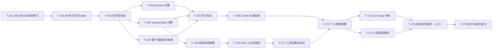

# M19–M22 实施规格：钩子强制、收工记忆、个人模式、真实项目闭环

日期：2026-11-26
状态：**已接受（随 ADR-013，审阅人 project owner，2026-11-26）**
语义契约：`docs/adr/ADR-013-personal-project-brain.md`（冲突时以 ADR 为准）
前置条件：① M18 真实验收关闭（T-157～T-160 全部完成）；② ADR-013 由具名人工审阅为"已接受"

> 本文件给执行 agent（ZCode 等）使用。每个任务都按 ANO 自身流程执行：`track create`（带 steps）→ 实现 → `verify`（含红队）→ `complete`（evidence_id）。不得以"文档写了"代替"已通过"。
> 文件路径依据 2026-11-26 的源码布局；实施时**按符号定位**，以运行代码和测试为准。

---

## 0. 总览



| 里程碑 | 任务 | 一句话目标 |
|---|---|---|
| 准备 | T-161 | 正式开放 M19–M22 |
| **M19 钩子强制** | T-162～T-168 | 开工自动注入、改前预防、收工检测，在 ZCode 上实测通过 |
| **M20 收工自动记忆** | T-169～T-171 | 每次会话自动留下可复算的摘要，下次开工自动浮出 |
| **M21 个人模式** | T-172～T-174 | 新项目 5 分钟接入，默认只露核心能力 |
| **M22 真实项目闭环** | T-175～T-176 | 在用户真实项目上连续 3 次会话证明初衷 |

**互斥约束**（编排时必须遵守）：`src/surface/service.ts` 是 churn 热点（26），只允许 T-170 修改它；`src/surface/cli.ts` 只允许 T-166 与 T-172 修改，且两者串行；`src/ledger/event.ts` 只允许 T-165 修改。

---

## T-161 ADR-013 登记与停止扩展契约修订（docs，P0）

- 改动：`docs/adr/ADR-013-personal-project-brain.md`（状态改为"已接受"并写明审阅人）；`README.md` 与 `AGENTS.md` 的"停止扩展契约"段加一句："ADR-013 授权 M19–M22，M22 关闭后契约以新范围重新生效"。
- 登记：`track` 建立 M19–M22 四个里程碑及 T-162～T-176。
- 验收：`npm run check-docs` 通过；PROJECT.md 路线图出现 M19–M22。

---

## M19 钩子强制

### T-162 S8 spike：ZCode 钩子实测（spike，P0，**阻断项**）

在**隔离测试项目**（`os.tmpdir()` 下的真实 Git 仓库，不用 ANO 自身仓库、不用用户真实项目）上实测，不预设结果：

| 编号 | 要实测的问题 | 记录 |
|---|---|---|
| Q1 | 钩子配置写在哪个文件、哪个键，user 与 workspace 作用域如何合并 | 原样配置片段 + 生效证据（主机日志） |
| Q2 | 7 个事件各自的 stdin JSON 字段（尤其 `session_id`、`cwd`、`tool_name`、`tool_input` 中的路径字段） | 每个事件 1 份脱敏样本 |
| Q3 | 内置编辑/写入类工具的确切工具名清单；shell 工具名 | 清单 |
| Q4 | `PreToolUse` 返回 deny/ask 的输出格式，模型侧看到什么 | 截图或日志 |
| Q5 | `SessionStart` 的 `additionalContext` 是否进入模型上下文，长度上限 | 实测 |
| Q6 | `Stop` 请求继续的格式、上限 3 次的计数方式、是否有"继续中"标志 | 实测 |
| Q7 | 钩子超时、非零退出、stdout 非 JSON 时宿主的行为 | 实测 |
| Q8 | 钩子进程的 cwd、环境变量、Windows 下中文与空格路径 | 实测 |

- 产出：`docs/spikes/S8-hooks.md` 与 `docs/evidence/s8-zcode-hooks.json`（样本脱敏，沿用 `src/clients/redact.ts`）。
- 判定门：Q1、Q2、Q4、Q5 任一不可用 → M19 降级为"仅 Claude Code 文档级 + 指令模式"，在 ADR-013 §9 追加结论，T-168 改为"如实不可用"后关闭。**不得**用合成样本冒充实测。

### T-163 钩子契约层（feature，P0）

- 新增 `src/hooks/contract.ts`：只含类型、zod `.strict()` schema 和纯函数，不 import `node:fs`/`node:child_process`。

```ts
export const HOOK_EVENTS = ['session-start', 'prompt', 'pre-tool', 'stop'] as const;
export const HOOK_MODES = ['advisory', 'strict'] as const;

export interface HookInput {               // 由客户端 adapter 归一化而来
  event: HookEvent;
  client: string;                          // 'zcode' | 'claude-code' …
  hostSessionId: string;                   // 宿主会话 ID；缺失则 fail-closed
  cwd: string;
  toolName?: string;                       // pre-tool
  targetPaths?: string[];                  // pre-tool：从 tool_input 提取并规范化
  stopContinuation?: boolean;              // stop：宿主"已在继续中"标志
  hostExtra?: Record<string, unknown>;     // 不参与判定
}

export type HookDecision = /* 见 ADR-013 §4.1 */;

export const HOOK_DEGRADED_CODES = [
  'HOOK_INPUT_INVALID', 'HOOK_ROOT_AMBIGUOUS', 'HOOK_TIMEOUT', 'HOOK_INTERNAL',
  'GRAPH_STALE', 'GRAPH_DEGRADED', 'UNSUPPORTED_LANGUAGE', 'NOT_GIT_ROOT',
] as const;

export function failClosedDecision(mode: HookMode, code: HookDegradedCode, detail: string): HookDecision;
// advisory → ask；strict → deny（pre-tool）；其他事件按 ADR-013 §4.2 的失败列
```

- 测试：`test/unit/hook-contract.test.ts`，覆盖每个 schema 的未知字段拒绝、缺字段拒绝，以及 `failClosedDecision` 的全组合（不得出现 `allow`）。
- 验收：契约层文件行、分支、函数覆盖 100%。

### T-164 pre-tool 判定引擎（feature，P0）

- 新增 `src/hooks/pre-tool.ts`：`decidePreTool(input, ctx): HookDecision`，按 ADR-013 §4.3 的 7 条规则顺序判定。
- 只读依赖：views.db 的 `exploredFiles`（复用 `exploredState` 投影，从 `service.ts` 抽到 `src/memory/` 或 `src/structure/` 下的纯读取函数；**抽取不改行为**，需有保护测试）、graph freshness、`hooks.exempt` 配置。
- 禁止：打开 Ledger 写句柄；触发 graph 重建；创建 `.ano/ledger` segment。
- 性能：`test/benchmark/hook-pre-tool.bench.ts`，在 1200 文件夹具上 P95 ≤ 300 ms（冷启动单独报告）。
- 测试：`test/unit/hook-pre-tool.test.ts`，7 条规则各有正反用例；同一输入重复判定结果一致；revision 变化后旧的 explored 失效。

### T-165 session-start / stop 引擎（feature，P0）

- 账本事件（`src/ledger/event.ts`，**只新增，不改已有 kind**；事件 schema hash 显式升版）：

```jsonc
// session.started
{ "host_session_id": "…", "client": "zcode", "hook_mode": "advisory",
  "head_commit": "<sha|null>", "dirty_baseline": [{ "path": "…", "sha256": "…" }],   // 上限 500，超限记 truncated
  "previous_session_unclosed": "<host_session_id|null>" }
// session.stop_checked
{ "host_session_id": "…", "seq": 1, "checks": [{ "id": "C1", "ok": false, "items": ["src/x.ts"] }],
  "decision": "continue" | "stop-ok", "continuations_used": 1 }
```

- 新增 `src/hooks/session.ts`：
  - `onSessionStart(input, ctx)`：写 `session.started`（幂等键 `session-start:<host_session_id>`），检测上一会话是否缺摘要（缺就交给 T-169 补写 `interrupted=true`），返回 brief 紧凑投影（T-170 提供，T-170 完成前先返回最小版：焦点任务 + 断点下一步）。
  - `onStop(input, ctx)`：计算 C1～C4（ADR-013 §4.4），写 `session.stop_checked`，`continue` 最多 2 次，尊重 `stopContinuation`。
- git 依赖复用 `src/core/git.ts`；非 Git 根 → `degraded=NOT_GIT_ROOT`，跳过 C1，其余照常。
- 测试：`test/integration/hook-session.test.ts`（真实 git、真实 SQLite、真实子进程执行 `ano hook`）：
  - 改了无归属文件 → `continue`，列出该文件；
  - 第 3 次 stop → 一定 `stop-ok`；
  - 同一 `host_session_id` 重放 session-start → 账本只有 1 条事件；
  - 会话中途被杀 → 下一次 session-start 检出上一会话未关闭。

### T-166 客户端适配、CLI 入口与安装（feature，P0）

- 新增 `src/hooks/adapters/zcode.ts`、`src/hooks/adapters/claude-code.ts`：`parse(stdin) → HookInput`，`render(decision) → { stdout, exitCode }`。字段映射**只能**来自 S8 实测（ZCode）或公开文档（Claude Code，标 `documented`）。
- CLI：`src/surface/cli.ts` 新增 `ano hook <event> --client <id> [--root] [--mode]`；读 stdin，限制 1 MiB；全程 try/catch → `failClosedDecision`；硬超时按 ADR-013 §2 第 9 条，用 `AbortSignal` 实现。
- 安装：扩展 `src/clients/install.ts` / `src/clients/config.ts`，增加 `--with-hooks`：
  - 只写 S8 确认的钩子键；沿用备份、漂移检查、原子合并、安装记录；`restore` 能还原；
  - 钩子命令固定为 `"<绝对 node 路径>" "<绝对 dist/surface/cli.js>" hook <event> --client <id> --root "<abs>"`，不拼接任何外部输入；
  - ZCode 现有"拒绝写"规则只对 `hooks` 段放开，`mcp` 段的行为不变（需要红队证明）。
- 能力层：`src/clients/capabilities.ts` 新增层 `enforcement`，取值 `hooks-validated | hooks-documented | instructions-only | unavailable`；`output-interception` 保持 `unavailable`，不改。
- 测试：`test/unit/hook-adapters.test.ts`（S8 脱敏样本作为夹具）、`test/integration/clients-install-hooks.test.ts`（dry-run 零写、confirm 写入、restore 还原、其他字段原样保留）。

### T-167 钩子红队（test，P0）

新增 `test/redteam/hooks-boundary.test.ts`，"先尝试钻，再断言钻不进"：

| 攻击 | 期望 |
|---|---|
| stdin 非 JSON、超 1 MiB、深层嵌套、缺 session_id | 降级为 ask/deny，不崩溃，不 allow |
| `targetPaths` 含 `..`、绝对路径逃出根、symlink/junction、UNC | ask，不 allow |
| `tool_input` 中嵌入 shell 元字符或换行 | 不进入任何命令行；判定不受影响 |
| 让钩子超时（注入慢 IO） | 硬超时触发，返回降级决定 |
| 伪造 `stopContinuation=false` 无限触发 stop | 同一会话最多 2 次 continue |
| 在 pre-tool 路径尝试写账本 | 测试断言 `.ano/ledger` 文件数不变 |
| 安装时 ZCode 配置被并发改动 | `beforeHash` 漂移拒绝，原文件不变 |
| Shell 工具写文件绕过 pre-tool | pre-tool 放行（如实），stop 的 C1 检出 |
| 自动摘要尝试作为 Gate 证据 | `track complete` 拒绝 |

### T-168 ZCode 实测验收（chore，P0）

- 在隔离测试项目上，用真实 ZCode 会话走完：安装钩子 → 新会话自动出现 brief → 未 explore 就改 TS 文件被 ask/deny → explore 后放行 → 留下无归属改动后收工被要求补记 → 补记后正常结束。
- 证据：`docs/evidence/m19-zcode-hooks-validation.md` + JSON（主机日志片段、账本事件 ID、钩子决定计数）。
- 通过后在客户端矩阵中把 ZCode 的 `enforcement` 标为 `hooks-validated`；Claude Code 保持 `hooks-documented`。

---

## M20 收工自动记忆

### T-169 机械会话摘要（feature，P0）

- 新增 `src/hooks/summary.ts`：`buildSessionSummary(sessionStarted, ledgerWindow, gitNow) → SessionSummary`（纯函数）+ `persistSessionSummary`（经既有 note 写路径，`kind=session_summary`，`source=hook:auto`）。
- 字段按 ADR-013 §5；`files_changed` 上限 200，`tasks` 上限 50，超限只给计数；**不含**任何提示词、回答或文件内容。
- 由 `onStop` 在每次 stop 结束时调用（`continue` 与 `stop-ok` 都写；同一会话后写覆盖语义用 seq 递增，brief 只取最新 seq）。
- `interrupted=true` 补写由 `onSessionStart` 调用。
- 测试：`test/unit/session-summary.test.ts`（确定性：相同输入字节级相同输出）、红队补充"摘要里不出现夹具中的假密钥与提示词"。

### T-170 brief"上次会话"段与紧凑投影（feature，P0；**唯一允许修改 service.ts 的任务**）

- `brief` 新增 `last_sessions`：最近 1 条摘要全文 + 最近 3 条一行摘要 + 所有未解决的 `unmet_checks`（解决判据：后续会话中对应任务有 checkpoint 或对应文件已归属）。
- 新增 `briefCompact(root, { budgetChars = 6000 })`，供 session-start 钩子使用。按优先级截断：焦点任务与断点 > unmet_checks > 上次摘要 > 锚定决策/踩坑 > 新鲜度 > 其他。截断时显式写 `truncated: [...]`。
- 默认 `brief` 输出形状只**新增**字段，不改已有字段（保护测试）。
- 测试：`test/unit/brief-compact.test.ts`（预算边界、截断顺序、中文字符按码点计数）。

### T-171 三会话连续集成测试（test，P0）

- `test/integration/three-session-continuity.test.ts`：真实 git + 真实 SQLite + 真实子进程钩子，模拟 3 次会话：
  1. 会话 1：建任务、改文件、未 checkpoint 就结束 → 摘要的 `unmet_checks` 含 C2；
  2. 会话 2：session-start 的 additionalContext 含会话 1 的断点与 C2 → 写 checkpoint 后 C2 解除；
  3. 会话 3：verify 通过并以 evidence_id complete → brief 不再出现该遗留。
- 验收：三段断言全部通过；`npm test` 全量无新增 skip。

---

## M21 个人模式

### T-172 profile 配置与默认可见性（feature，P1）

- 配置载体：ANO 当前没有 `.ano/config.toml` 实体。实施前先确认现有配置读取位置；没有就新增 `src/core/config.ts`，读取 `.ano/config.toml`（只解析 `profile`、`hooks.mode`、`hooks.exempt`、`hooks.prompt_hint` 四个键，未知键报警告但不失败）。
- 新项目（`setup`/`init` 创建）默认 `profile="personal"`、`hooks.mode="advisory"`；已有项目没有配置文件时按 `full` 处理（**不迁移**）。
- CLI：`--help` 按 profile 分组；新增 `ano help --all`。`doctor` 在 personal 下只显示已安装的客户端，`--all` 展开全部。
- 测试：`test/unit/config-profile.test.ts`、CLI 帮助快照测试。

### T-173 `ano setup` 向导（feature，P1）

- `ano setup --root <abs> --client <id> [--yes-dry-run]`：
  1. 预检（git 根、Node 版本、`.pm/` 是否存在、客户端是否安装）；
  2. 存在 `.pm/` 时：打印 `takeover grant` 内容 → TTY 确认 → grant → 再次确认 → `apply --confirm`；
  3. 钩子：`clients install --with-hooks` 的 dry-run diff → TTY 确认 → 写入；
  4. 写 `.ano/config.toml`（personal）；
  5. `doctor` 自检；
  6. 打印"第一次会话这样开口"的示例提示。
- 非 TTY：只输出完整计划，零写入。每个写步骤单独确认，任一步拒绝则停止，已完成的步骤给出对应 restore/disable 命令。
- 验收：在隔离夹具项目上，从零到"第一次会话出现 brief"的步骤计时 ≤ 5 分钟（人工计时，记录在证据中）。

### T-174 MCP 工具描述精简（chore，P2）

- 先查明 `tool-catalog.ts` 的 schema hash 是否包含 description：包含则本任务需要显式升版，并更新 `scripts/verify-zcode-mcp.ts` 的期望；不包含则只改文案。
- personal 下的 description 每个 ≤ 200 字符，讲清"何时调用"；参数 schema 不变。
- 验收：`npm run gen-docs && npm run check-docs` 通过；ZCode 真实握手仍是 7 个工具。

---

## M22 真实项目闭环

### T-175 真实项目闭环（chore，P0，**需要具名人工**）

- 前置：用户具名指定项目路径；`ano setup` 走完；人工在 TTY 完成全部确认。
- 执行：在该项目上进行 3 次真实工作会话（每次至少 1 个真实小任务），会话内容由用户决定，ANO 不预设。
- 指标采集：新增 `scripts/m22-metrics.ts`（只读账本与钩子事件），输出 ADR-013 §7 列出的全部指标；误拦需要人工逐条标注。
- 证据：`docs/evidence/m22-real-project-loop.md` + JSON。
- 停止判据：按 ADR-013 §7。触发即把默认模式锁为 `advisory` 并登记调整任务，不得改口径来"通过"。
- 关闭：必须由具名人工确认；任务 Gate 通过**不构成**该确认。

### T-176 收口与契约复位（docs，P0）

- `docs/limitations.md` 新增两节："钩子强制边界（M19）"（三道防线覆盖面、shell 绕过、revision 绑定取舍、客户端分级）与"个人模式边界（M21）"。
- `README.md`、`AGENTS.md`：停止扩展契约更新为"M22 为最后一个产品里程碑"；AGENTS.md 开工段写明"已安装钩子的客户端会自动注入 brief"。
- `docs/delivery-status.md`、`docs/client-compatibility.md` 更新 enforcement 列。
- 根据 M22 数据，在 ADR-013 §8 的"何时重议"列写入实际数值（例如不受支持语言的改动占比）。

---

## 附录 A：全局验收清单（M22 关闭前逐项打勾）

- [ ] MCP 工具数仍为 7（真实握手）
- [ ] 全客户端 `output-interception` 仍为 `unavailable`
- [ ] 钩子任何失败路径都不产生 `allow`（红队证明）
- [ ] pre-tool 路径零账本写入（测试证明）
- [ ] 自动摘要无法作为 Gate 证据（测试证明）
- [ ] 钩子配置可以 `restore` 回装前字节（测试证明）
- [ ] ZCode `enforcement=hooks-validated` 有实测证据
- [ ] 三会话连续集成测试通过
- [ ] 真实项目 3 次会话证据齐全，并由具名人工确认
- [ ] 全量 `npm test` 0 fail，无新增 skip；覆盖率不低于 M18 基线
- [ ] limitations、README、AGENTS 已更新，`check-docs` 通过

## 附录 B：交给执行 agent 的开工指令（M18 关闭、ADR 接受之后使用）

```text
你在 <repo> 工作。先调用 ANO brief。
本轮目标是 M19（ADR-013 + docs/m19-m22-implementation-spec.md）。
严格遵守 AGENTS.md 与 ADR-013 §2 的硬边界。
从 T-162（S8 spike）开始：只在 os.tmpdir() 下的隔离 Git 项目实测 ZCode 钩子，
不得修改 ANO 仓库以外的任何真实配置，不得用合成样本冒充实测。
每个任务都要 track create（带 steps）→ 实现 → verify（含红队）→ complete（evidence_id）。
遇到 S8 判定门不通过，立即停止 M19 的后续实现并上报，不要绕路。
```
