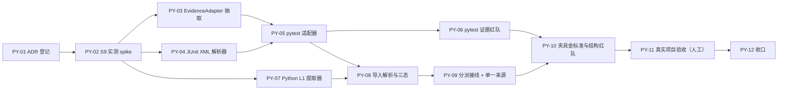

# M23 实施规格：Python 语言包（pytest 证据 + L0/L1 结构）

日期：2026-11-27
状态：**已接受**，随 ADR-014 由 project owner 于 2026-11-27 具名审阅；开工边界以 ADR-014 为准。
语义契约：`docs/adr/ADR-014-python-language-pack.md`（冲突时以 ADR 为准）
机器可读登记清单：`m23-registration.json`（与本文件同批提交，建议放 `docs/m23-registration.json`）
前置条件：ADR-014 由具名人工审阅为"已接受"。**不需要**等 M22 关闭：M22 剩下的只是真实项目上的人工步骤，与 M23 没有文件冲突。

> 依据 2026-11-27 的源码布局（`src/gate/` 下还没有 `adapters/`；`src/structure/extractors/` 只有 `ts.ts`；`src/core/config.ts` 只解析 `profile` 与 `hooks.*`；`src/hooks/pre-tool.ts` 硬编码了一份受支持扩展名）。实施时**按符号定位**，以运行代码和测试为准。

---

## 0. 编号说明

旧规格里的 M23 编号 T-177～T-186 已被执行 agent 用在别的修复任务上（当前最大任务号是 T-179）。本规格改用**稳定的标题前缀 PY-01～PY-12**，与仓库已有的 `MNT-01` 写法一致。实际 `T-xxx` 编号由登记工具分配，按顺序登记约为 T-180～T-191。

任务 `type` 只用仓库现有取值（feature / chore / fix / refactor / debt），原来的 spike、test、docs 一律记为 chore。

## 1. 依赖图



PY-08 依赖 PY-05，只是因为两者都要读 `src/core/config.ts` 的新键（`python.roots` 由 PY-05 加入），不是逻辑依赖。

## 2. 任务总表

| 前缀 | 标题 | type | 段 | 依赖 |
|---|---|---|---|---|
| PY-01 | ADR-014 登记与停止扩展契约修订 | chore | — | — |
| PY-02 | S9 spike：Python/pytest 与 tree-sitter-python 实测 | chore | 共用 | PY-01 |
| PY-03 | 抽出 EvidenceAdapter，原样迁移 Node 证据逻辑 | refactor | M23a | PY-02 |
| PY-04 | 零依赖受限 JUnit XML 解析器 | feature | M23a | PY-02 |
| PY-05 | pytest 适配器、解释器白名单与 Python 配置键 | feature | M23a | PY-03, PY-04 |
| PY-06 | pytest 证据红队 | chore | M23a | PY-05 |
| PY-07 | Python L1 提取器 | feature | M23b | PY-02 |
| PY-08 | Python 导入解析与三态映射 | feature | M23b | PY-07, PY-05 |
| PY-09 | 多语言分派接线与受支持扩展名单一来源 | feature | M23b | PY-08 |
| PY-10 | 夹具金标准、T1 覆盖与结构红队 | chore | 汇合 | PY-06, PY-09 |
| PY-11 | 真实 Python 项目只读验收（**需用户指定项目**） | chore | 汇合 | PY-10 |
| PY-12 | M23 收口：文档、能力声明与契约复位 | chore | — | PY-11 |

每个任务的 steps、验收标准和涉及文件都在 `m23-registration.json` 里，登记时原样填入，不要再改写。

## 3. 互斥约束（编排必须遵守）

| 文件 | 只允许修改的任务 |
|---|---|
| `src/gate/verify.ts` | PY-03、PY-05（串行） |
| `src/gate/evidence.ts` | PY-03 |
| `src/core/config.ts` | PY-05 |
| `src/structure/extractor.ts` | PY-09 |
| `src/hooks/pre-tool.ts` | PY-09 |
| `src/surface/service.ts` | **无**（churn 热点 29，M23 不碰） |

## 4. 关键实现要点（摘自 ADR-014，便于执行时对照）

**PY-03 是纯迁移**：先保存 Node 证据快照，迁移后同输入的 Evidence/Verdict 必须字节级一致；现有 `test/redteam/verify-evidence.test.ts` 和 `verify-hardening.test.ts` 零改动全绿。做不到就回退，不要"顺手改进"。

**PY-05 的拒绝清单**：裸 `python`/`python3`/`py`/`pytest`；用户自带 `--junitxml`；`-p <插件>`（`-p no:` 除外）；`--collect-only`/`--co`；`--setup-only`/`--setup-plan`；`--fixtures`；`-c`；指向项目根外的 `--rootdir`；`-m` 后跟非 pytest 模块；除 `-X utf8` 外的 `-X`。

**PY-05 的配置键**：在 `src/core/config.ts` 只新增 `python.interpreter`（绝对路径）与 `python.roots`（字符串数组）。其余未知键维持现状，只产生 warning。

**PY-09 的单一来源**：`pre-tool.ts` 的 `SUPPORTED_PRE_TOOL_EXTENSIONS` 改为从结构层导出派生，删除手写副本，并加一条两者恒等的测试。这样结构开关一打开，改 `.py` 就自动要求先 `explore`，不会出现静默漏防。

**开关**：`ENABLE_PYTHON_STRUCTURE` 默认 false，只有 PY-11 判定后才由 PY-12 打开。

## 5. 全局验收清单（M23 关闭前逐项打勾）

- [ ] ADR-014 已接受，ADR-013 已接受的文本未被改写
- [ ] `package.json` 依赖不变（零新依赖）
- [ ] Node 证据路径迁移前后字节级一致
- [ ] 裸 `python`、自带 `--junitxml`、自定义插件、`--collect-only` 全部被拒
- [ ] Python 与 Node 的 done 公式一致，skipped 同样阻止完成
- [ ] JUnit XML 解析器覆盖 100%，实体攻击不 OOM
- [ ] 钩子与结构层的受支持扩展名恒等
- [ ] 开关关闭时，现有结构测试与电商证据数值完全不变
- [ ] Python 夹具边判定与金标准逐条一致
- [ ] 支持状态如实为 `supported` 或 `supported-fixture-only`
- [ ] 全量 `npm test` 0 fail，无新增 skip；覆盖率不低于 M18 基线
- [ ] limitations 有 Python 一节；README 等对外表述与状态一致；`check-docs` 通过
- [ ] MCP 工具数仍为 7（真实握手）

## 6. 交给执行 agent 的开工指令

```text
你在 <repo> 工作。先调用 ANO brief。

第一步只做登记（PY-01）：
1. 把会话交付的 ADR-014-python-language-pack.md 放到 docs/adr/，m23-implementation-spec.md
   和 m23-registration.json 放到 docs/。ADR-014 状态保持"草案"，等我具名审阅后再改为已接受。
2. 用项目现有的里程碑与任务登记方式，按 docs/m23-registration.json 原样登记：
   里程碑 M23，以及 PY-01～PY-12 十二个任务（标题、type、priority、steps、acceptance、files、tags、
   milestone=M23 全部照抄，不要改写，不要合并或拆分）。任务号由登记工具分配。
3. 在 T-176 的 checkpoint 里追加一句：停止扩展契约须等 M22 与 M23 都关闭后才复位（ADR-014 §10）。
4. 刷新 PROJECT.md，确认路线图出现 M23 和 12 个任务，然后停下来向我报告分配到的任务号。

ADR-014 被我接受之前，不要开始 PY-02 及之后的任何实现。
不得修改 ADR-013 已接受的文本，不得修改 src/surface/service.ts，不得新增依赖。
```

ADR-014 接受后，再给执行 agent 这一段：

```text
ADR-014 已接受。从 PY-02（S9 spike）开始做 M23。
只在 os.tmpdir() 下新建隔离 Python 项目实测，不得用合成样本冒充实测。
PY-03 是纯迁移：先保存现有 Node 证据快照，迁移后必须字节级一致，否则回退。
严格遵守 docs/m23-implementation-spec.md 第 3 节的互斥约束。
ENABLE_PYTHON_STRUCTURE 在 PY-11 判定前保持 false。
每个任务都要：登记 steps → 实现 → verify（含红队）→ complete。2026-11-27 流程修订后，M23 的 PM 任务以当前源码 PM 质量证据验收，不伪造原生 ANO evidence_id；见 ADR-014 §10。
PY-11 需要我指定真实 Python 项目，到那一步停下来问我。
```
